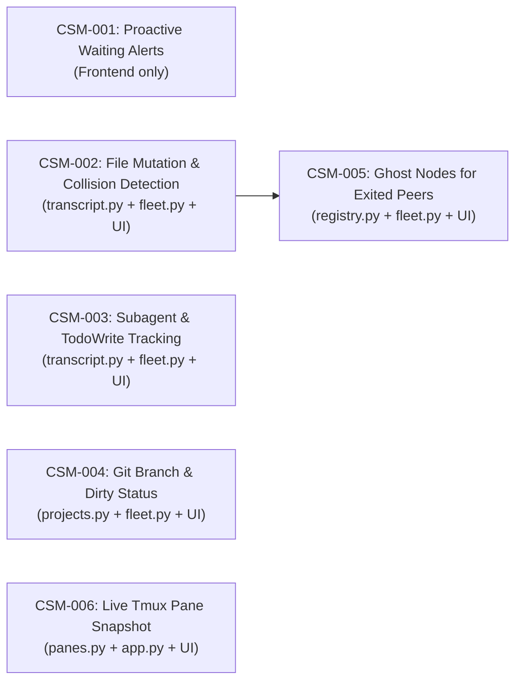
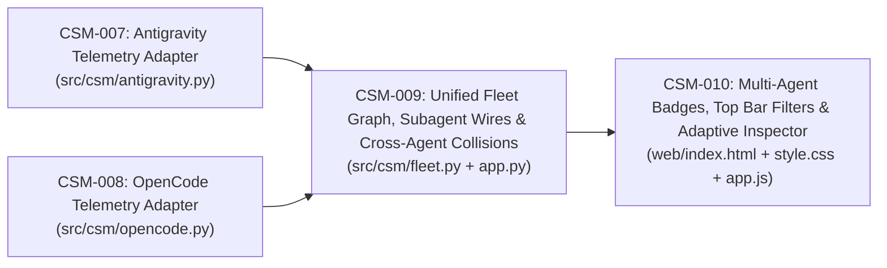

# Claude Session Monitor — Phase 2 Backlog (`tickets/`)

Bộ ticket triển khai **Phase 2: Operational Telemetry** dựa trên bản đặc tả kỹ thuật. Tất cả các ticket đều tuân thủ nguyên tắc **Zero-Config & Read-Only**.

## Sơ đồ Phụ thuộc & Thứ tự Triển khai

## Danh sách Tickets

| ID | Tiêu đề | Ưu tiên | Độ phức tạp | Trạng thái | File liên quan |
| --- | --- | --- | --- | --- | --- |
| [CSM-001](file:///home/trungdh/dev/tools/claude-session-monitor/tickets/CSM-001-proactive-waiting-alerts.md) | Cảnh báo chủ động khi có phiên `Đang chờ` (Dynamic Title/Favicon, Web Audio & Notification) | P0 (High) | S | `DONE` | `web/index.html`, `web/style.css`, `web/app.js` |
| [CSM-002](file:///home/trungdh/dev/tools/claude-session-monitor/tickets/CSM-002-file-collision-detection.md) | Theo dõi File chỉnh sửa & Cảnh báo xung đột ghi đè giữa các phiên (`File Collision`) | P0 (High) | M | `DONE` | `src/csm/transcript.py`, `src/csm/fleet.py`, `web/app.js`, `web/style.css` |
| [CSM-003](file:///home/trungdh/dev/tools/claude-session-monitor/tickets/CSM-003-subagents-and-todos.md) | Trích xuất tiến độ công việc (`TodoWrite`) và lịch sử gọi Subagent (`Agent` / `Task`) | P1 (Medium) | M | `DONE` | `src/csm/transcript.py`, `src/csm/fleet.py`, `web/app.js`, `web/style.css` |
| [CSM-004](file:///home/trungdh/dev/tools/claude-session-monitor/tickets/CSM-004-git-branch-worktree-telemetry.md) | Hiển thị nhánh Git hiện tại (`branch`) và trạng thái thay đổi (`dirty`) trên mỗi phiên | P1 (Medium) | S | `DONE` | `src/csm/projects.py`, `src/csm/fleet.py`, `web/app.js`, `web/style.css` |
| [CSM-005](file:///home/trungdh/dev/tools/claude-session-monitor/tickets/CSM-005-exited-ghost-sessions.md) | Lưu trữ "Bóng mờ" (Ghost Nodes) cho các phiên vừa kết thúc để bảo toàn luồng hội thoại | P2 (Medium) | M | `DONE` | `src/csm/registry.py`, `src/csm/fleet.py`, `web/index.html`, `web/app.js`, `web/style.css` |
| [CSM-006](file:///home/trungdh/dev/tools/claude-session-monitor/tickets/CSM-006-live-tmux-pane-snapshot.md) | Xem trực tiếp màn hình Terminal (`tmux capture-pane`) ngay trong Inspector | P1 (High) | M | `DONE` | `src/csm/panes.py`, `src/csm/app.py`, `web/app.js`, `web/style.css` |

---

## Phase 3: Multi-Agent Telemetry (Claude Code + Antigravity + OpenCode)

| ID | Tiêu đề | Ưu tiên | Độ phức tạp | Trạng thái | File liên quan |
| --- | --- | --- | --- | --- | --- |
| [CSM-007](file:///home/trungdh/dev/tools/claude-session-monitor/tickets/CSM-007-antigravity-adapter.md) | Bộ thu thập Telemetry cho Antigravity (`presence/*.lock`, `conversation_summaries.db`, `transcript.jsonl`, `artifacts`) | P0 (High) | M | `DONE` | `src/csm/antigravity.py`, `tests/test_multi_agent.py` |
| [CSM-008](file:///home/trungdh/dev/tools/claude-session-monitor/tickets/CSM-008-opencode-adapter.md) | Bộ thu thập Telemetry cho OpenCode (`opencode.db` `session_v2` & `session_message`, `/proc` & `tmux`) | P0 (High) | M | `DONE` | `src/csm/opencode.py`, `tests/test_multi_agent.py` |
| [CSM-009](file:///home/trungdh/dev/tools/claude-session-monitor/tickets/CSM-009-unified-fleet-and-wires.md) | Hợp nhất Đồ thị Fleet, Dây nối Subagent Cha-Con & Đụng độ File xuyên công cụ | P0 (High) | M | `DONE` | `src/csm/fleet.py`, `src/csm/app.py`, `tests/test_multi_agent.py` |
| [CSM-010](file:///home/trungdh/dev/tools/claude-session-monitor/tickets/CSM-010-multi-agent-ui-and-inspector.md) | Giao diện Badge Công cụ (`CLAUDE`/`ANTIGRAVITY`/`OPENCODE`), Bộ lọc Agent & Inspector thích ứng | P1 (High) | M | `DONE` | `web/index.html`, `web/style.css`, `web/app.js` |
| [CSM-011](file:///home/trungdh/dev/tools/claude-session-monitor/tickets/CSM-011-3d-office-department-view.md) | Chế độ Kép `2D Sơ đồ ↔ 3D Phòng ban` (Isometric 3D Cyber-Office với Bàn làm việc, Nhân vật Agent & Cáp âm sàn) | P1 (High) | M | `DONE` | `web/index.html`, `web/style.css`, `web/app.js` |
